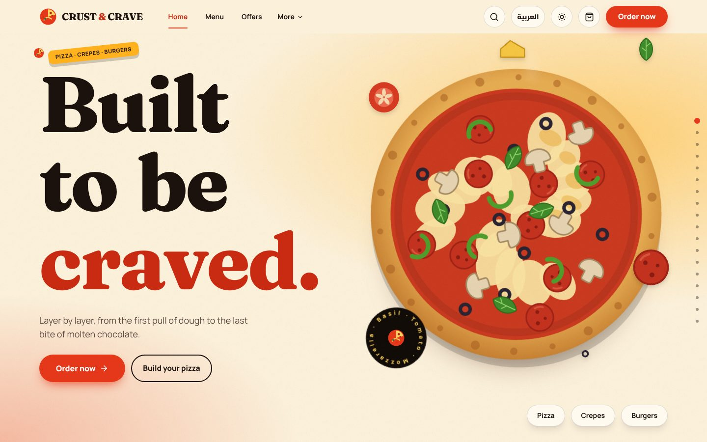
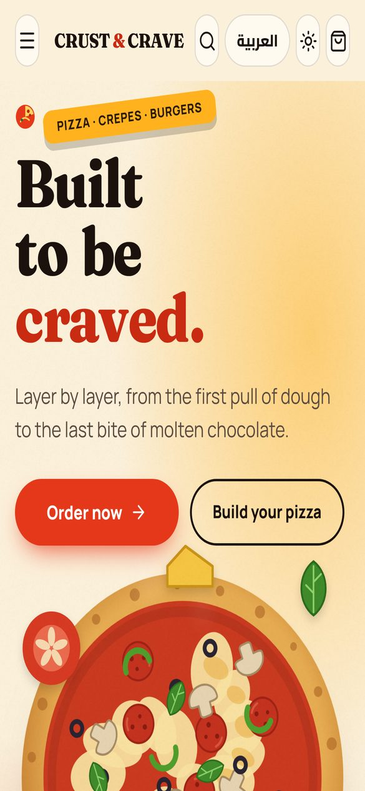

<div align="center">

# Crust & Crave

**A cinematic, bilingual (EN / AR) restaurant storefront built with Next.js 16, React 19 and GSAP.**

Digital menu · live product customiser · cart & demo checkout · RTL · light/dark themes · Playwright E2E in CI

[](https://nextjs.org/)
[](https://react.dev/)
[](https://www.typescriptlang.org/)
[](https://tailwindcss.com/)
[](https://gsap.com/)
[](https://motion.dev/)
[](https://playwright.dev/)
<br/>
[](https://github.com/Eslamraafat1/New-Restaurant/actions/workflows/e2e.yml)
[](https://new-restaurant-kappa.vercel.app)

**[Live Demo](https://new-restaurant-kappa.vercel.app)** · **[Portfolio](https://new-portfolio-ashy-xi.vercel.app)** · **[LinkedIn](https://www.linkedin.com/in/eslamraafat-dev/)**

</div>

<table>
  <tr>
    <td width="72%" align="center"></td>
    <td width="28%" align="center"></td>
  </tr>
  <tr>
    <td align="center"><sub>Desktop · 1440×900</sub></td>
    <td align="center"><sub>Mobile · iPhone 13</sub></td>
  </tr>
</table>

> [!NOTE]
> **Crust & Crave is a fictional brand.** This is a front-end portfolio project: orders are simulated in the browser and never reach a restaurant. Branches, contact details, reviews and legal text are labelled placeholders.

---

## Table of contents

- [Overview](#overview)
- [Key features](#key-features)
- [Tech stack](#tech-stack)
- [Architecture highlights](#architecture-highlights)
- [SEO & performance](#seo--performance)
- [Testing & QA](#testing--qa)
- [Known limitations](#known-limitations)
- [Project structure](#project-structure)
- [Getting started](#getting-started)
- [Deployment](#deployment)
- [Author](#author)
- [License](#license)

## Overview

Crust & Crave is a complete restaurant storefront for a pizza / crepe / burger brand: a scroll-driven animated homepage, a filterable digital menu (32 products across 9 categories in the demo catalogue), product pages with a live illustrated customiser, a persistent cart and a validated checkout flow. Everything is available in **English and Arabic (RTL)** with **light, dark and system themes**.

The front-end is **backend-ready**. All data flows through a typed API layer (`lib/api/*`) that runs against local demo data or a real REST backend, switched by one environment variable. The API contract for the back-end developer is documented in [`docs/BACKEND_INTEGRATION.md`](docs/BACKEND_INTEGRATION.md).

## Key features

### Menu & product customiser
- Digital menu with a sticky category rail, text search, dietary filters (vegetarian / vegan / spicy), sorting, grid/list views, a wishlist filter and a mobile filter drawer.
- **Quick View** modal and a dedicated, pre-rendered page for every product (`/product/[slug]`).
- Live customiser: priced option groups (size, sauce, toppings…) with required and maximum-selection rules; the layered **SVG pizza illustration updates as you add toppings**.
- Skeleton, error and empty states for menu data.
- Global search dialog with a **Ctrl / ⌘ + K** shortcut.

### Cart & checkout
- Persistent cart (localStorage) with one line per unique configuration, quantity limits and **edit customisation** for existing lines.
- Slide-out cart drawer, wishlist and toast notifications.
- Pricing logic in `lib/pricing.ts`: option surcharges, "included" defaults, a delivery fee with a free-delivery threshold, and demo coupons (`CRAVE10`, `WELCOME30`).
- Checkout with **delivery or pickup** (branch selector) and client-side validation with labelled, described errors. The order-confirmation screen appears only after the order call succeeds.

### Motion
- **GSAP + ScrollTrigger** pinned scenes: pizza assembly (sauce splash, cheese rain, cut lines, ingredient callouts), crepe and burger scenes, and a pinned horizontal "signature reel" with 3D cards.
- Letter-flip hero with toppings flying in, 3D pointer tilt, a velocity-driven skewing marquee, magnetic CTAs, a custom cursor, site-wide scroll reveals and a one-time brand intro curtain.
- **Lenis** smooth scrolling synced with ScrollTrigger, and **Framer Motion** for UI transitions such as dialogs and the header.
- Breakpoint-aware animation via `gsap.matchMedia()`. Pointer effects only run on devices with a fine pointer and hover.

### Internationalisation & RTL
- Full **English / Arabic** dictionary (`lib/i18n`) with a `useI18n()` hook (`t`, `l`, `money`), and `{ en, ar }` strings throughout the data model.
- **Server-rendered language, no English flash**: the choice is stored in a `cc-lang` cookie. `proxy.ts` rewrites each request (URLs stay the same) to the prerendered `app/[lang]` tree, so Arabic visitors receive Arabic HTML with `<html lang="ar" dir="rtl">` on the first byte. Both languages are fully static; switching language is still instant on the client.
- Logical CSS properties (`start` / `end`) and a dedicated Arabic typeface (Cairo) alongside Fraunces and Manrope, loaded through `next/font`.

### Themes
- Light, dark and system themes driven by CSS custom properties in `app/globals.css`.
- The saved theme is applied **before paint** to avoid a flash of the wrong theme, and the `theme-color` meta tag follows the colour scheme.

### Performance
- Every menu category and product page is pre-rendered with `generateStaticParams`, and **Cache Components / Partial Prerendering** stream content behind `Suspense` skeletons.
- All food art is **hand-built layered SVG** rather than photography, so the catalogue ships no raster images.
- Fonts are self-hosted through `next/font/google`.
- A measured fix from development QA: an SVG `feTurbulence` grain overlay dropped headless-Chrome frame rate to about 1 FPS. It was replaced with a pre-rendered noise tile (`public/noise.png`), which ran at 60 FPS in the same test.

### SEO
- `metadataBase` + a `pageMeta()` helper (`lib/site.ts`): unique title, description, **canonical URL**, **Open Graph** and **Twitter card** on every route; `generateMetadata` on category and product pages.
- `app/robots.ts` and `app/sitemap.ts`: the sitemap lists every indexable page, all 9 menu categories and all 32 dishes.
- Branded share image generated with `next/og` (`app/opengraph-image.tsx`).
- **JSON-LD**: `Restaurant` + `WebSite` on the home page, `Menu` → `MenuSection` → `MenuItem` (with `Offer` price in EGP and `suitableForDiet`) on the menu, `MenuItem` on product pages, and `BreadcrumbList` on menu, category and product pages. No address, phone, opening hours or ratings are emitted because those are placeholders in this demo.
- The site URL resolves from `NEXT_PUBLIC_SITE_URL`, then Vercel's production domain, then the production URL, so canonicals can never point at `localhost`.
- `/admin` (no auth), `/cart`, `/checkout` and `/order` are `noindex` and excluded from the sitemap; `/admin` also sends `X-Robots-Tag: noindex, nofollow`.
- Unknown routes, categories and products return a real **HTTP 404** (in demo mode the proxy checks the slug before streaming starts).

### Accessibility
- **Reduced motion is respected**: GSAP scenes, Lenis, the custom cursor and the intro curtain are turned off, and final states are shown statically.
- Accessible dialogs and drawers: rendered in a portal with `role="dialog"` and `aria-modal`, a **focus trap**, Esc to close, scroll lock and focus restore.
- Skip-to-content link, keyboard-operable controls, labelled form fields and `aria-pressed` toggle buttons.

## Tech stack

| Area | Technology | Version |
|---|---|---|
| Framework | [Next.js](https://nextjs.org/) (App Router, Cache Components, Turbopack) | 16.4.3 |
| UI library | [React](https://react.dev/) | 19.3.0 |
| Language | [TypeScript](https://www.typescriptlang.org/) (`strict`) | 5.9 |
| Styling | [Tailwind CSS](https://tailwindcss.com/) + CSS custom properties | 4.3 |
| Scroll animation | [GSAP](https://gsap.com/) + ScrollTrigger | 3.15 |
| UI animation | [Framer Motion](https://motion.dev/) | 14.7 |
| Smooth scroll | [Lenis](https://lenis.darkroom.engineering/) | 1.3 |
| Icons | [Lucide React](https://lucide.dev/) | 1.63 |
| Utilities | `clsx`, `tailwind-merge` | — |
| Linting | ESLint + `eslint-config-next` (core-web-vitals, typescript) | 9.39 |
| E2E testing | [Playwright](https://playwright.dev/) | 1.63.0 |
| CI / hosting | GitHub Actions · Vercel | — |

## Architecture highlights

- **App Router** with 17 page routes (`/`, `/menu`, `/menu/[category]`, `/product/[slug]`, `/cart`, `/checkout`, `/order`, `/offers`, `/about`, `/our-story`, `/ingredients`, `/contact`, `/locations`, `/faq`, `/privacy`, `/terms`, `/admin`), plus custom `not-found`, `error` and `global-error` boundaries. Pages live under `app/[lang]` (the root layout) and are prerendered for `en` and `ar`; `proxy.ts` maps the public URL to the right language from the `cc-lang` cookie.
- **Cache Components** (`cacheComponents: true`): server components await `params` inside `Suspense` boundaries, so the static shell is served immediately and the dynamic parts stream in.
- **One data layer** (`lib/api/*`): components never contain URLs. A typed `apiFetch` wrapper adds a 10-second timeout via `AbortController` and turns failures into a typed `ApiError` (`http` / `timeout` / `network`). `NEXT_PUBLIC_USE_DEMO_API` switches between demo data and the real backend.
- **Typed contract**: `lib/api/types.ts` is the source of truth for every field. Demo Route Handlers in `app/api/*` mirror the REST contract (`/menu`, `/products`, `/products/:id`, `/categories`, `/offers`, `/branches`, `/orders`, `/contact`).
- **State without a library**: a small `useSyncExternalStore`-based store (`lib/store.ts`) persists cart, coupon, wishlist and theme to localStorage and syncs across tabs through the `storage` event. It uses the initial value as the server snapshot, so hydration never mismatches. The language store uses the server-rendered locale as its snapshot and persists to a cookie.
- **Centralised branding**: name, currency, fees, coupons and contact placeholders live in `lib/brand.ts`, and colours are design tokens in `app/globals.css`.
- **Resilient build**: `generateStaticParams` falls back to bundled demo data if the backend is unreachable at build time.

## SEO & performance

What is implemented today:

| Concern | Implementation |
|---|---|
| Titles & descriptions | Title template plus a unique title and description per route; `generateMetadata` on product and category pages |
| Canonical, Open Graph, Twitter | Absolute canonical, `og:*` and `summary_large_image` on every page; generated 1200×630 share image |
| Crawling | `robots.txt` (points to the sitemap) and `sitemap.xml` (52 URLs); private/transactional pages are `noindex` |
| Structured data | `Restaurant`, `WebSite`, `Menu`/`MenuSection`/`MenuItem`, `BreadcrumbList` JSON-LD |
| Status codes | Unknown routes, categories and products return 404 |
| Pre-rendering | `generateStaticParams` for every category and product; Partial Prerendering via Cache Components |
| Fonts | Self-hosted with `next/font` |
| Images | Vector SVG illustrations, no raster product photos |
| Theme and locale flash | Language is server-rendered from a cookie (no flash); a pre-hydration script sets `data-theme` before first paint |
| Mobile | `viewport-fit=cover` and a colour-scheme-aware `theme-color` |

Not done: separate public `/ar/...` URLs with `hreflang` (Arabic shares the English URL and is chosen by cookie, so search engines index the English version).

## Testing & QA

### Automated E2E tests (Playwright)

The [`e2e/`](e2e) package (own `package-lock.json`, Playwright 1.63.0) holds **35 tests**. They run in two projects, **Desktop Chrome** and **Mobile Chrome (Pixel 7)**; the request-level SEO checks run on desktop only, so a full run is **57 test runs**. Motion is set to `reduce` so GSAP/Lenis settle instantly and the flows stay deterministic.

| Suite | What it checks |
|---|---|
| `smoke.spec.js` | 10 key pages return **HTTP 200** with the correct `<title>` and **no console or hydration errors**; an unknown route returns 404 |
| `flows.spec.js` | Category page shows only that category; **dietary filter and search narrow the results**; **sorting** by price reorders dishes; the menu category rail jumps to a section; the **customiser updates the live price** (140 → 195 → 210 → 125); **add to cart → header count → cart subtotal and coupon → checkout totals incl. delivery fee → validation errors and focus → demo order success** with the cart cleared |
| `preferences.spec.js` | **Language switch** sets `lang="ar" dir="rtl"`, writes the cookie, and the **reloaded server HTML is already Arabic**; switching back restores `ltr`; **theme toggle** persists across reloads; unknown page/product/category return **404** with `noindex` |
| `seo.spec.js` | `robots.txt` references an absolute sitemap; `sitemap.xml` lists all categories and dishes and no private pages; canonical (absolute `https`, never localhost), `og:*` and Twitter tags on 5 page types; OG image renders; `/admin` and `/checkout` are `noindex`; JSON-LD parses and contains `Restaurant`, `Menu` (9 sections), `MenuItem` with price and a 4-level `BreadcrumbList` |

```bash
cd e2e
npm ci
npx playwright install chromium
npm test                                   # against the live site
LOCAL=1 npm test                           # starts the local production build (run `npm run build` in the root first)
BASE_URL=http://localhost:3000 npm test    # against any running server
npm run report                             # open the HTML report
```

### Continuous integration

[`.github/workflows/e2e.yml`](.github/workflows/e2e.yml) runs on every push to `master`, on every pull request and on manual dispatch (Node 20): `npm ci` → `npm run lint` → `npm run typecheck` → `npm run build` → the Playwright suite against the **locally started production build**. The HTML report is uploaded as an artifact for 14 days. A separate manual job (`workflow_dispatch` with `target=live`) runs the same suite against the live deployment.

### Manual and scripted QA during development

Earlier development passes (headless Chrome on production builds, not re-run here) recorded 252 layout checks (18 pages × 7 widths from 320 to 1920 px × EN/AR) with 0 horizontal scrolls and 0 console errors, and fixed a horizontal scroll at 1024 px, a sticky-bar overflow at 320 px and header-logo wrapping at 320 px. Not yet verified: real devices, screen readers, Safari and Firefox.

## Known limitations

- Orders, payments, auth and persistence are not implemented: checkout is a demo and `/admin` is an unauthenticated preview (labelled on the page and `noindex`).
- Branches, contact details, ratings/reviews and legal text are placeholders or sample data.
- Food art is layered SVG illustration, not photography.
- Arabic has no separate URL (see SEO above).

## Project structure

```text
.
├── app/
│   ├── [lang]/             # Root layout + all pages, prerendered for en and ar
│   ├── api/                # Demo Route Handlers mirroring the REST contract
│   ├── robots.ts, sitemap.ts, opengraph-image.tsx
│   └── globals.css         # Design tokens
├── proxy.ts                # Cookie-based language rewrite + demo-mode 404s
├── components/
│   ├── art/                # Layered SVG food illustrations (live pizza preview, crepe, burger)
│   ├── cart/               # Cart, checkout, order success
│   ├── chrome/             # Header, footer, drawers, modal, search dialog, site shell
│   ├── fx/                 # Site-wide GSAP effects (scroll reveals, cursor, intro curtain)
│   ├── home/               # Homepage scenes (hero, pinned scenes, reel)
│   ├── menu/               # Menu view, product cards, quick view
│   ├── pages/              # Info and legal pages
│   └── product/            # Product page and customiser
├── data/demo/              # Demo catalogue, options, offers, branches, copy
├── lib/
│   ├── api/                # Typed data layer (config, client, errors, services, types)
│   ├── i18n/               # EN/AR dictionary + useI18n()
│   ├── brand.ts            # Brand config: name, currency, fees, coupons
│   ├── cart.ts, store.ts   # Persisted cart / wishlist external store
│   ├── pricing.ts          # Price calculation and option validation
│   ├── site.ts             # Site URL, per-page metadata helper, JSON-LD helpers
│   ├── structured-data.ts  # schema.org builders
│   └── theme.tsx, gsap.ts  # Theme and GSAP / Lenis helpers
├── e2e/                    # Playwright tests and config
├── docs/                   # Backend integration guide, screenshots
└── .github/workflows/      # CI (E2E tests)
```

## Getting started

**Prerequisites:** Node.js **20.9 or later** (required by Next.js 16) and npm.

```bash
git clone https://github.com/Eslamraafat1/New-Restaurant.git
cd New-Restaurant
npm install
cp .env.example .env.local   # demo mode is the default
npm run dev                  # http://localhost:3000
```

### Environment variables

| Variable | Default | Description |
|---|---|---|
| `NEXT_PUBLIC_USE_DEMO_API` | `true` | `true` serves bundled demo data and simulates orders in the browser; `false` calls the real backend |
| `NEXT_PUBLIC_API_BASE_URL` | `http://localhost:8000/api` | Example address of the real REST API (no trailing slash) |
| `NEXT_PUBLIC_SITE_URL` | production URL | Absolute site origin for canonical URLs, sitemap, robots and JSON-LD. Optional: falls back to Vercel's production domain, then `https://new-restaurant-kappa.vercel.app` |

These are build-time `NEXT_PUBLIC_*` values, so restart the dev server or rebuild after changing them.

### Scripts

| Command | Description |
|---|---|
| `npm run dev` | Start the development server |
| `npm run build` | Create a production build |
| `npm start` | Serve the production build |
| `npm run lint` | Run ESLint |
| `npm run typecheck` | Generate route types and type-check the project |
| `cd e2e && LOCAL=1 npm test` | Run the Playwright E2E suite against the local build |

## Deployment

The app is deployed on **Vercel** at **[new-restaurant-kappa.vercel.app](https://new-restaurant-kappa.vercel.app)**. Any host that supports Next.js 16 works: set the environment variables above and run `npm run build && npm start`.

To connect a real backend, set `NEXT_PUBLIC_USE_DEMO_API=false` and `NEXT_PUBLIC_API_BASE_URL`; the UI needs no other changes. The endpoints, payloads and the rules the server must re-implement (such as recomputing prices server-side) are in [`docs/BACKEND_INTEGRATION.md`](docs/BACKEND_INTEGRATION.md).

## Author

**Eslam Raafat**, Front-End Developer (React · Next.js · TypeScript)

- Portfolio: [new-portfolio-ashy-xi.vercel.app](https://new-portfolio-ashy-xi.vercel.app)
- LinkedIn: [linkedin.com/in/eslamraafat-dev](https://www.linkedin.com/in/eslamraafat-dev/)
- GitHub: [@Eslamraafat1](https://github.com/Eslamraafat1)
- Email: [eslamraafat736@gmail.com](mailto:eslamraafat736@gmail.com)

## License

[MIT](LICENSE) © 2026 Eslam Raafat. Crust & Crave is a fictional brand.

---

<sub>Contributors: this project runs on a Next.js version with breaking changes. Read `AGENTS.md` and `node_modules/next/dist/docs/` before changing framework code.</sub>
